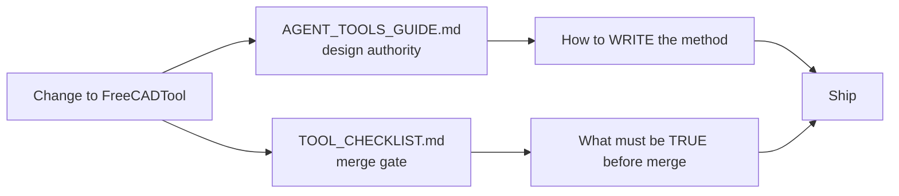
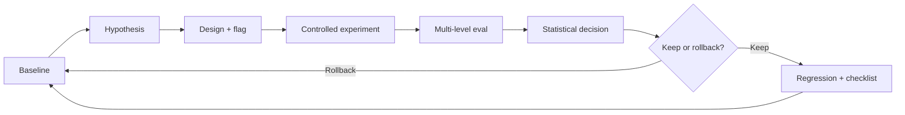
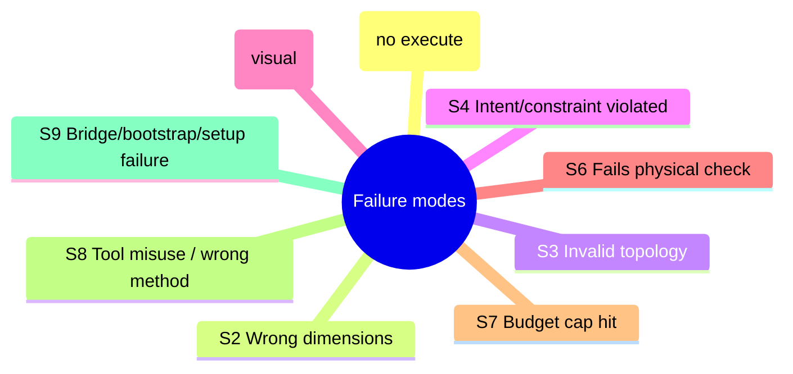
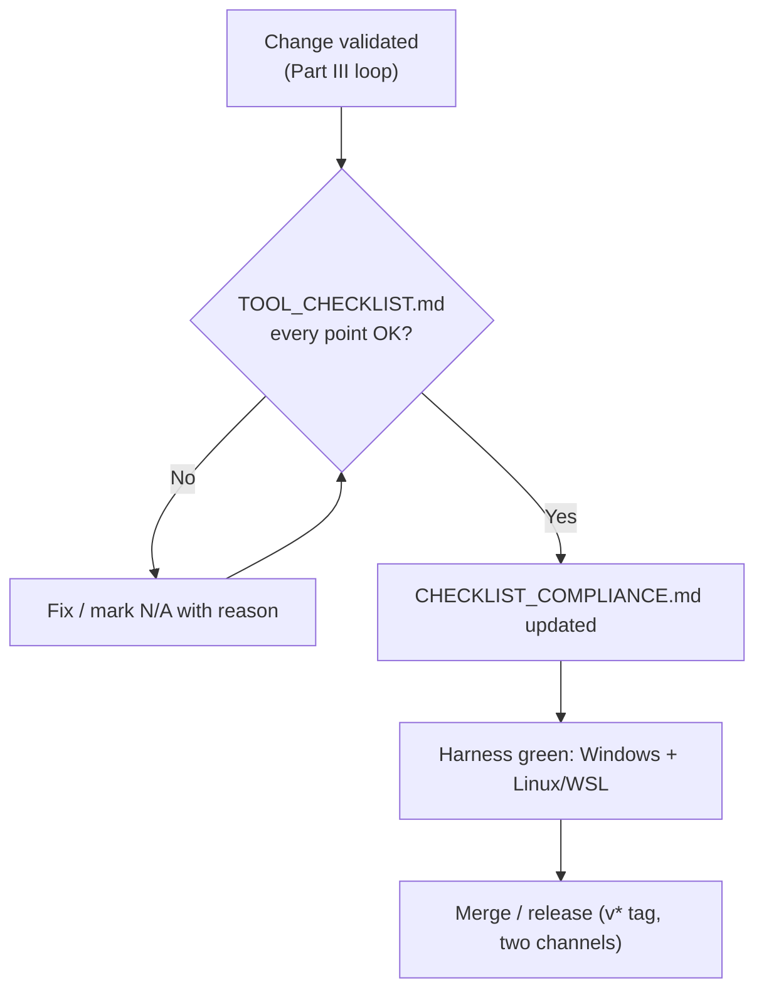

# Improving FreeCADTool

## An Architecture-Grounded, Agent-Guide-Aligned Methodology

> **Audience:** whoever changes `FreeCADTool` — adding a method, a parameter, a Python snippet,
> or a fix. This document replaces the generic "scientific framework" draft with one tied to the
> **actual** tool, the **actual** rules, and the **actual** merge gate.
>
> **Two documents govern every change.** Read them first, every time:
> - [`../AIOrchestrator/API/AGENT_TOOLS_GUIDE.md`](../AIOrchestrator/API/AGENT_TOOLS_GUIDE.md) — the **design authority** (how a tool and its methods must be written).
> - [`../AIOrchestrator/API/TOOL_CHECKLIST.md`](../AIOrchestrator/API/TOOL_CHECKLIST.md) — the **merge gate** (what must be true before a change ships). See §19 — it is mandatory.

---

## Part I — The Ground Truth

### 1. What FreeCADTool is (and is not)

`FreeCADTool` is a **Graphene-Lab plugin tool** — a C# class deriving from `BaseAgentTool` (and
`IFileTool`) that lets an LLM agent drive CAD operations. The single most important fact about
its architecture:

> **FreeCADTool contains no CAD kernel.** It is a thin, pure-managed **.NET RPC client** to a
> **live FreeCAD process** running the `RobustMCPBridge` add-on. Every geometric operation is a
> Python snippet sent over the bridge; the real work is done by FreeCAD's Python API on top of
> OpenCASCADE, inside the FreeCAD process. The pattern is the same as WebTool↔Chromium: the tool
> is a remote controller, not the engine.

Consequences that shape every improvement decision:

- **The kernel is the source of truth, never the LLM.** Geometry is computed by FreeCAD/OCC and
  read back. The agent never "reasons out" a volume or a validity flag — it asks the kernel.
- **The bridge is the single choke point.** One method (`execute(code)`) carries everything.
  Observability, error handling, and timeouts all live there.
- **Setup is the tool's job.** On first use it auto-starts a headless FreeCAD + the bundled
  bridge, and auto-installs the FCGear add-on on the first gear request, surfacing progress and
  failures as localized OS notifications.
- **It is a plugin, not core.** It ships through the standard two-channel plugin pipeline and is
  loaded from the host's `Tools/FreeCADTool/` folder.

### 2. The real architecture

Anchor every change to these files (no `freecad_tool.py`, no `flags.yaml`, no LangGraph — those
were placeholders in the old draft and do not exist here):

```
FreeCADTool/
  FreeCADTool.cs            # main partial class: connection, documents, objects,
                           #   primitives, booleans, gear call-through, import/export, undo/redo
  FreeCADTool.PartDesign.cs # PartDesign features: sketch, pad/pocket/revolve/groove, patterns,
                           #   edge ops (fillet/chamfer)
  FreeCADTool.View.cs       # view/screenshot/visibility/display_mode/color (GUI-only)
  FreeCADTool.PartsLibrary.cs # get_complex_part: search the public FreeCAD-library first
  FreeCADTool.FCGear.cs     # FCGear auto-install + involute-gear helpers
  FreeCADTool.Chat.cs       # InstallChatMod / EnsureChatMod (the FreeCAD-side chat dock)
  FreeCADTool.Enums.cs      # DocumentAction, PrimitiveKind, BooleanOperation, UndoRedoAction, …
  FreecadBridge.cs          # JSON-RPC 2.0 client (newline-JSON over TCP), lazy connect + reconnect
  FreeCADBootstrap.cs       # IsBridgeUp / EnsureBridge: auto-start headless FreeCAD + bridge
  FreeCADStrings.cs         # localized user-facing setup strings (OS UI language)
  bridge_headless.py, bridge/  # the Python bridge payload the tool starts (its own files)
  AgentBridgeChat/          # the Python/PySide chat add-on the tool installs into FreeCAD's Mod dir
  freecad-AI/               # vendored UPSTREAM reference (excluded from build/pack)
  FreeCADTool.Harness/      # C# console harness — the verification suite
  FreeCADTool.Scenarios/    # C# field-test scenarios
  CHECKLIST_COMPLIANCE.md   # per-point TOOL_CHECKLIST conformity (kept current)
  MAINTENANCE.md            # upstream drift + adoption policy
```

**The bridge contract** (`FreecadBridge.cs` → `ExecResult`). Every operation round-trips through
`execute(code)` and returns a normalized record:

```
ExecResult(Success, Result, Stdout, Stderr, ErrorType, ErrorTraceback)
```

The Python snippet puts its return value in the variable `_result_`; the bridge returns
`{success, result, stdout, stderr, error_type, error_traceback}`. The C# side maps a failed
`ExecResult` to an agent-facing `Error: …` string via the private `Err(...)` helper. **This is the
deterministic core** — design every method so the kernel's real answer, not the model's guess,
reaches the agent.

**Method families actually present** (the surface you extend — see §7 before adding to any of them):

| Family | Methods (snake_case the agent sees) | Notes |
|---|---|---|
| Connection | `status` | call first; auto-bootstraps |
| Document | `document` (List/Create/Open/Save/Close/Recompute) | active-doc default; Save/Export versioned |
| Objects | `list_objects`, `inspect_object`, `delete_object`, `create_object`, `edit_object`, `transform` | names feed every other method |
| Primitives | `create_primitive` (Box/Cylinder/Sphere/Cone/Torus/Wedge/Helix) | closed set = enum |
| Booleans | `boolean` (Fuse/Cut/Common) | returns `valid`, `volume` |
| PartDesign | sketch + pad/pocket/revolve/groove + patterns + fillet/chamfer | `FreeCADTool.PartDesign.cs` |
| Gear | `create_gear` | FCGear call-through, auto-installs |
| Parts library | `get_complex_part` | search-first rule (see §2.1) |
| Import/Export | `import_file`, `export` (step/stl/3mf/obj/iges) | `SandboxPath` + `GitSupport.Snapshot` |
| View | `view` (screenshot/visibility/display_mode/color) | **GUI-only** |
| Undo/Redo | `undo_redo` (Undo/Redo/Status) | **GUI-only** for Undo/Redo |

#### 2.1 The lean-orchestrator first-line rule (non-obvious, load-bearing)

AgentBridge runs a **lean orchestrator**: plugin tools sit behind `launch_subagent`, and the
orchestrator's planning catalog carries **only the first line** of each tool's class-level
`<summary>` (`Terminal.GetClassDescriptionFirstLine`). The rest of the summary is visible only to
the subagent that does the work.

> **Any rule the *planner* must follow has to live on the FIRST line of the class summary.** A rule
> on line two is invisible where the work is planned. This was observed live: the planner ordered
> primitives because the "search the libraries first with `get_complex_part`" rule was not on line
> one. It is on line one now, and the live agent test passes because of it.

When you add a method that changes *which tool/approach the agent should pick*, update the **first
line** of the class summary, not just the method doc.

#### 2.2 GUI vs headless, and cross-version robustness

- **GUI-only operations** (`view` screenshot/visibility/display_mode/color, `undo_redo`
  Undo/Redo) cannot run headless. The tool raises a clear `Error:` in headless mode rather than a
  silent no-op or a wrong result. Preserve that behavior — never let a GUI-only op pretend to
  succeed headless.
- **Cross-version (FreeCAD 0.20 ↔ 1.x).** The tool is verified against FreeCAD 1.1.3 (Windows)
  and 0.20.2 (Linux/WSL). New Python snippets must be robust across **both** API generations —
  e.g. sketch-to-plane attachment handles the 1.x `AttachmentSupport`/`Origin.getObject` API and
  the 0.20 `Support`/`OriginFeatures` Role-match API. Test on both before shipping.

#### 2.3 Two-channel release + plugin layout

A change ships through the standard plugin pipeline (AGENT_TOOLS_GUIDE §3–§8): date-based csproj
version (`1.yy.MM.dd`); a `v*` tag triggers **both** `.github/workflows/plugin-release.yml`
(GitHub Release zip → hosts' `Tools/FreeCADTool/`) and `.github/workflows/publish.yml` (NuGet
`Graphene.FreeCADTool`). The plugin **never ships `AIOrchestrator.dll` or its dependency graph**
(the host provides it; `plugin-release.yml` strips it). The tool carries no foreign native dlls —
FreeCAD is external, the bundled Python bridge/chat are the tool's own plain files.

### 3. The two governing documents



The improvement loop in Part III is how you **find** good changes. Part II and §19 are how you
**make each change compliant**. Both are required: a method that helps the agent but breaks a
checklist rule does not ship.

---

## Part II — The Design Gate (alignment with AGENT_TOOLS_GUIDE)

Every method you add or modify must satisfy the AGENT_TOOLS_GUIDE rules. They are summarized here
with the real FreeCADTool examples; the authoritative text is the guide itself.

### 4. Agent-facing description rules

The agent learns each method only from its XML docs (rendered to Markdown + JSON schema by
`Analyzer.GetToolDefinitions`). Therefore:

- **Outcomes, not internals.** Never mention the RPC wire format, the Python code generation, the
  `_result_` variable, or the bridge transport in a method doc. `create_gear` says *"Create a
  parametric involute gear"* — not *"send a FCGear Python snippet over JSON-RPC"*.
- **Minimal.** Short, one instruction per `///` line. The class summary is a one-line competency
  plus cross-method rules; it does not explain individual methods.
- **What, not how.** `boolean` says *"Boolean-combine solids: Fuse, Cut, or Common"* — the
  OpenCASCADE `fuse/cut/common` calls stay hidden.
- **No sandbox talk.** Nothing tells the agent it is in a sandbox or that paths are virtual. Paths
  are described as relative to the **workspace root** (leading `/`, e.g. `/out/model.step`).
- **Formats specified.** Lengths in **mm**, angles in **degrees**, JSON property keys and allowed
  values listed per method (see `create_primitive`'s per-kind keys).
- **Cross-references.** Parameters that come from another method say so: *"object name from
  `list_objects`"*, *"sketch must exist before adding geometry"*, *"start with
  `document(create)`"*.
- **Actionable errors.** Every failure returns `Error: <cause> — <detail>` (the `Err(...)` helper
  pulls `error_traceback`/`stderr`/`error_type`). No raw exception ever reaches the agent.

### 5. Use enums for closed value sets

A parameter whose input is a fixed set is a C# `enum`, never a `string` with a `switch`. The real
FreeCADTool enums are the model to follow: `DocumentAction`, `PrimitiveKind`, `BooleanOperation`,
`UndoRedoAction`. The generated scheme lists the allowed member names and the dispatcher rejects
anything outside the set before your code runs. Reserve `string` for genuinely free-form input
(names, paths, JSON property blobs). Inside the method, convert a member to text with
`nameof(EnumType.Member)`, never `ToString()`-and-reparse.

### 6. Surface & sandbox discipline

- **Only agent-relevant operations are public.** The RPC client (`FreecadBridge`) and the helpers
  (`Run`, `Err`, `Py`, `PyJson`, `N`, `Field`) are private/internal. The only inherited public
  member is `BaseAgentTool.LoadSkill`. Never widen the public surface with a helper.
- **Every file-handling method** resolves with `SandboxPath.TryResolve`/`Resolve` and converts any
  host path shown to the agent with `SandboxPath.ToAgent`. No `Path.GetFullPath`, no host paths.
- **No public method escapes the sandbox** or exposes credentials, configuration, or host paths.
  `get_complex_part`, for example, downloads only into the sandbox workspace and reports
  workspace-relative paths.

### 7. The "few methods" principle — merge before you add

The tool's standing rule (MAINTENANCE.md): **add the fewest methods possible.** Every public
method is a permanent surface the agent must learn and the harness must cover.

- New **variant** of an existing operation → add an **enum member** to the existing method's
  action enum, not a new method.
- New **parameter** on an existing operation → add an **optional parameter**.
- A **new method** only for a genuinely distinct operation with no natural home.

This principle tempers the whole "add method M" framing of Part III: the cheapest good change is
often *not* a new method.

### 8. Reuse the shared AIOrchestrator helpers

Do not hand-roll what the orchestrator already provides:

- `Log.LogStep(...)` at the entry of every public method (plus the rich outcome log at the `Run()`
  RPC choke point).
- `SandboxPath.Resolve`/`TryResolve`/`ToAgent` for all path work.
- `GitSupport.Snapshot(path, message)` right after every file write (`export`, `document` save,
  `view` screenshot); rollback stays centralized in `GitTool` — no custom backup.
- `SystemNotifier.Notify(title, body, seconds)` for OS desktop notifications (Windows balloon /
  macOS osascript / Linux notify-send) — never a per-OS path.
- `FreeCADStrings` for user-facing setup strings, localized to the OS UI language with English
  fallback — no hardcoded single-language messages.

---

## Part III — The Improvement Loop

The scientific core of the original draft, kept — but with the harness, the "flag", and the
metrics tied to the real tool. Treat each enhancement as a falsifiable hypothesis validated against
a frozen baseline, promoted only on evidence.



### 9. Phase 0 — Freeze the baseline

Before any change, freeze a reference point and run it:

- **Tool version:** the current `FreeCADTool` (git tag / commit).
- **Agent config:** model, temperature, prompt, agent set — pinned and recorded.
- **Task suite:** a fixed set of CAD tasks stratified over the real method families (sketching,
  primitives, PartDesign features, booleans, gear, parts-library search, import/export,
  measurement/inspection). Report **per stratum**, not just aggregate — a change that helps
  primitives may hurt PartDesign.
- **Harness:** the existing `FreeCADTool.Harness` (41 checks) + `FreeCADTool.Scenarios` (10
  field tests), run against a **live headless FreeCAD on both Windows and Linux/WSL**. The harness
  is the evaluation harness — extend it, do not replace it.
- **Seeds:** a fixed seed list, identical across conditions, for paired comparisons.

Record the baseline distribution: success rate per task/stratum, all metrics (§12), token cost,
tool-call count, latency, and the failure-mode taxonomy (§12.8).

### 10. Phase 1 — Falsifiable hypothesis

```
H: Adding <method/enum-member/param> M will improve metric X on stratum S by ≥ Δ,
   without degrading metric Y on stratum S' by more than ε,
   at a cost increase ≤ C tokens and ≤ L seconds per task.
Rationale: [observed failure / literature pattern / trace analysis]
Falsification: [what observation rejects H]
```

Prioritize by **(expected impact × probability of success) / cost**, favoring changes that are
cheap to make behind a flag, compose with existing methods, and address a failure seen in ≥ 3
strata. Remember §7: prefer an enum member over a new method when the impact is equal.

### 11. Phase 2 — Design the method (behind a reversible flag)

The old draft's `FEATURES.get("new_method_M")` does not exist. The real, reversible "flag" is one
of:

- a **git branch / worktree** carrying the new method (the baseline branch is the control),
- the **exposed method set** (a method that is not public is invisible to the agent),
- an **environment switch** for behavior variants (the tool already uses
  `FREECAD_DISABLE_AUTOINSTALL`, `FREECAD_HOST`, `FREECAD_PORT`, `FREECAD_TIMEOUT_MS`).

Whatever the mechanism, the harness records which configuration was active per run, and the change
is revertible without touching the harness (P6 — reversibility).

Design the method itself to the Part II rules: typed/structured `_result_`, deterministic kernel
core (the geometry is computed by FreeCAD, never the LLM), self-describing `Error:` with the
offending entity and the kernel message, `Log.LogStep`, `SandboxPath`/`GitSupport` if it writes
files, enum for any closed set, and — if it changes tool choice — the **first-line** summary rule
(§2.1).

### 12. Phase 3 — Controlled experiment

For each hypothesis run **Control (C)** = baseline, and **Treatment (T)** = baseline + M, with:

- **Paired seeds** — identical seed list across C and T so each pair is matched.
- **N runs per task per condition** — ≥ 5 screening, ≥ 10 promotion, ≥ 20 high-stakes.
- **Randomized order**, **model version pinned**, all confounds (temperature, top_p, max_tokens,
  system/task prompts, max tool calls, timeout, harness version) held constant and recorded.
- **Blinding** for VLM judges — randomized, unlabeled renders.

### 13. Phase 4 — Multi-level evaluation (mapped to what the bridge returns)

Evaluate every run across complementary levels. Crucially, the geometric/topological levels are
**read from the kernel through the bridge**, not estimated — the tool already surfaces these
(`inspect_object`, `boolean`, `create_gear` return `valid`, `closed`, `volume`, `area`,
`faces`/`edges`/`vertexes`):

| Level | What | Source |
|---|---|---|
| L1 Syntactic | snippet executed without error (`Success`, no `error_type`) | `ExecResult` |
| L2 Geometric | volume/area/bbox deviation vs target, IoU/Chamfer vs reference | kernel read-back |
| L3 Topological | `Shape.isValid()`, `isClosed()`, face/edge/vertex counts vs reference | kernel read-back |
| L4 Constraint/intent | sketch fully constrained, feature built as intended | kernel + rubric |
| L5 Visual (VLM) | blind rubric on multi-view renders | blinded VLM |
| L6 Physical (where relevant) | mass properties / FEA where the task needs it | kernel / FEA |
| L7 Cost | tokens, RPC round-trips, FreeCAD recompute time, tool calls, iterations | harness |

**Failure-mode taxonomy** (compare distributions between C and T — a shift from a worse to a milder
mode is a win even at flat success rate):



S9 is architecture-specific: a connection/bootstrap failure is its own class, distinct from a bad
model decision — never let it masquerade as a modeling failure.

### 14. Phase 5 — Statistical analysis

- **Paired tests:** Wilcoxon signed-rank for continuous metrics (volume deviation, IoU, tokens);
  McNemar for binary outcomes (valid/invalid, success/fail).
- **Bootstrap CIs** for effect sizes; report median diff (T−C), 95% CI, p (Holm-Bonferroni
  across strata), effect size (Cliff's delta).
- **Promotion gate:** aggregate improvement significant (p < 0.05 after correction) **AND** no
  stratum regresses beyond ε **AND** cost within the pre-registered budget.
- **Pareto:** prefer non-dominated methods (quality vs cost); a method dominated on all axes at
  higher cost is rejected even if its raw gain looks good.

### 15. Phase 6 — Promote / promote-with-caveats / revise / rollback

- **Promote:** significant win, no regression, budget OK, no new failure modes → merge, update
  baseline, tag.
- **Promote with caveats:** partial win → conditional activation + documented limitation.
- **Revise:** mixed but plausibly fixable → redesign, re-run; do not promote the current version.
- **Rollback:** no win or regression → revert the flag/branch, archive, document the failure.

### 16. Phase 7 — Regression & composition

After any promotion, re-run the **full** harness (all strata, N ≥ 5, both OSes) against the new
baseline: no previously passing task may now fail; no previously promoted method may be
neutralized. Then re-run the hypothesis queue — previously rejected hypotheses may become viable.

### 17. Phase 8 — Documentation & knowledge base

Each cycle writes a structured record (Appendix B): hypothesis, method, flag, baseline/treatment
versions, task suite, seeds, per-stratum results, failure-mode shift, decision, rationale, threats
to validity, follow-ups. This is the searchable institutional memory of the tool's evolution.

---

## Part IV — Architecture-Specific Rules & Anti-Patterns

### 18. Per-change rules (the "add it right" list)

When you add or modify a method:

1. **Right home first** (§7): enum member or optional param before a new method.
2. **Python snippet robust across FreeCAD 0.20 ↔ 1.x** (§2.2); put the value in `_result_`.
3. **Structured result** so the harness and the agent see the same canonical state.
4. **`Error:` on failure** via `Err(...)`; never a raw exception, never a silent no-op (esp.
   GUI-only ops headless).
5. **`Log.LogStep`** at entry; rely on the `Run()` choke-point log for the outcome.
6. **File writes:** `SandboxPath.TryResolve` + return the workspace-relative path + `GitSupport.Snapshot`.
7. **Enum** for any closed set; `nameof` for text conversion.
8. **Tool-choice rule → first line** of the class summary (§2.1).
9. **Update the harness** with a check for the new capability; keep it green on Windows + Linux/WSL.
10. **Update `CHECKLIST_COMPLIANCE.md`** for any touched checklist point.
11. **Never** add the AIOrchestrator graph or a foreign native dll to the plugin.

### 19. Anti-patterns

**Experimental (from the original draft, still valid):** unpaired runs; single-run decisions;
aggregate-only reporting; ignoring cost; promoting multiple methods at once; harness drift;
trusting VLM judges blindly; skipping failure-mode analysis; forgetting composition.

**Architecture-specific (new, grounded in this tool):**

- **Adding a method when an enum member would do** — grows the permanent surface for nothing (§7).
- **Putting a tool-choice rule on line 2 of the class summary** — invisible to the lean planner (§2.1).
- **Leaking internals into docs** — naming the bridge, the Python snippet, or `_result_` in a method
  doc breaks the "outcomes not internals" rule.
- **A Python snippet that works on 1.x but breaks on 0.20** (or vice versa) — violates the
  cross-version contract; test both.
- **A GUI-only op returning success headless** — must raise a clear `Error:` instead.
- **`Path.GetFullPath` / host paths** instead of `SandboxPath` — breaks the sandbox boundary.
- **A bare file name in a result** instead of the workspace-relative path — the agent cannot report
  or attach the file.
- **Hand-rolled notifications or strings** instead of `SystemNotifier` / `FreeCADStrings`.
- **Shipping `AIOrchestrator.dll`** or a foreign native dll in the plugin folder.
- **Treating a bridge/bootstrap failure (S9) as a modeling failure** — masks setup problems as
  model errors.

---

## Part V — The Final Gate

### 20. ALWAYS verify against `TOOL_CHECKLIST.md`

> **No change to `FreeCADTool` is complete — and must not be merged — until it has been checked,
> point by point, against
> [`../AIOrchestrator/API/TOOL_CHECKLIST.md`](../AIOrchestrator/API/TOOL_CHECKLIST.md).**

This is the closing, mandatory step of every cycle, regardless of how the change was validated
experimentally. Concretely:

1. **Run the full checklist** on the changed tool before merging — every section: Release & layout,
   Agent-facing descriptions, Surface & sandbox, Code & conventions, Standardized support.
2. **Keep [`CHECKLIST_COMPLIANCE.md`](CHECKLIST_COMPLIANCE.md) current.** For **every** checklist
   point it states conformity or `N/A — <one-line reason>` — never a bare "OK", never a silently
   dropped point. Update it whenever the change touches a point (a new enum param, a new
   file-writing method needing `SandboxPath` + `GitSupport.Snapshot`, a new public method, a
   changed class summary, etc.).
3. **The harness stays green** on **both** Windows and Linux/WSL — the cross-platform contract is
   part of compliance.
4. **Re-check the guide** if the checklist itself changed: the full rules live in
   `AGENT_TOOLS_GUIDE.md`; the checklist is the actionable subset, and the compliance file is the
   per-tool proof.



The experimental loop tells you the change **helps**. The checklist tells you the change is
**compliant**. Both are required before it ships.

---

## Appendix A — Hypothesis sources: the 2026 CAD-agent literature

The patterns below are a **hypothesis source** for §10. Each is paired with what it means for a
tool that is a thin C# RPC client to FreeCAD (not a kernel, not a code-gen MCP server). Treat the
reported numbers as the papers' claims, not as verified here.

**Proactive clarification (ProCAD).** Audit the prompt and ask targeted questions only when needed
for a self-consistent spec. *For FreeCADTool:* clarification is the agent/orchestrator's job, not
a tool method — but a method doc that states its preconditions ("sketch must exist before adding
geometry", "start with `document(create)`") is the tool-side contribution to fewer ambiguous
calls.

**Stratified skill library (Embodied CAD, L0–L4).** Constrain the model to semantically meaningful
skills; leave coordinate frames, face selection, and booleans to deterministic resolvers. *For
FreeCADTool:* this is exactly the architecture — the agent picks a skill (`pad`, `fillet`,
`boolean`), the kernel does the bookkeeping. Reinforces "few high-level methods, deterministic
core."

**Test-contract (SPADA).** Generate code **and** deterministic tests as an executable contract.
*For FreeCADTool:* the `FreeCADTool.Harness` checks are the contract; every new capability gets a
check that asserts the kernel-level truth (`isValid`, volume, face count), not a vibe.

**Solver grounding / read-back (CADSmith, CADSmith's outer loop).** Measure bbox, volume, face
counts, validity from the kernel and feed them back. *For FreeCADTool:* already the model —
`inspect_object`/`boolean`/`create_gear` return these; design new methods to return the same
canonical metrics so the eval levels (L2/L3) are kernel-sourced.

**Symbolic, not photorealistic rendering (AADvARK).** Unique colors/textures per face/edge for VLM
interpretation. *For FreeCADTool:* relevant to the `view` family and to the L5 VLM eval — prefer
distinctive renders over pretty ones.

**Physics-in-the-loop (Self-Improving CAD + CalculiX; Physics-in-the-Loop).** Return a compact FEA
report (failed requirements, measured margins) as a feedback signal. *For FreeCADTool:* a candidate
future family (L6) — only if it stays in CAD-core scope and the "few methods" rule (§7).

**Multi-agent compact state (MAC).** Pass structured state, not raw conversation → large token
savings. *For FreeCADTool:* aligns with the lean-orchestrator split — the subagent gets the whole
plugin set; the orchestrator carries only the first-line summary. Keep results structured and
small.

**Memory / trace-guided repair (TraceCAD, memory-augmented RL).** Persist attempted/failed/
succeeded steps and reuse repairs; avoid "retrieval traps." *For FreeCADTool:* the cycle record
(Appendix B) and the knowledge base are the tool-side memory; the parts-library index cache
(`get_complex_part`) is a retrieval that must avoid infeasible matches.

**Intermediate representation (CADIR, ArtisanCAD CAD-IR).** Separate design representation from
execution backend for cross-backend editing and skill distillation. *For FreeCADTool:* our IR is
the method surface + the `_result_` contract; the FreeCAD feature tree is the editable backend.
Keep the surface stable; the backend (FreeCAD version) can move under it.

**Consensus selection (Siemens).** Sample multiple programs, return the one agreeing most with the
pool — training-free. *For FreeCADTool:* a candidate eval tactic for ambiguous tasks (run N, pick
the modal valid result), cheap to prototype behind a flag.

**Benchmarks to borrow task strata from:** CADWorld (200 FreeCAD long-horizon tasks, 11 categories),
CAD-bench (executable, reference solutions), MUSE (editable B-Rep assemblies, rubric VLM),
SPADA-Bench-Verified (real assemblies + deterministic tests). Use their category spread to build
the stratified task suite in §9 so per-stratum reporting is meaningful.

---

## Appendix B — Reference cycle record

```json
{
  "cycle_id": "C-2026-0NN",
  "hypothesis": "Adding <M> improves <X> on <S> by >= Δ without degrading <Y> beyond ε",
  "change_kind": "new_method | enum_member | optional_param | fix",
  "flag": "branch:feat/... | exposed_set | env:VAR",
  "baseline_version": "FreeCADTool@<git-tag/commit>",
  "treatment_version": "FreeCADTool@<...>+<M>",
  "freecad_versions": ["1.1.3 (Windows)", "0.20.2 (Linux/WSL)"],
  "task_suite": "FreeCADTool.Harness + Scenarios @<date>",
  "seeds": [1, 2, 3, 4, 5],
  "results": {
    "aggregate": { "valid_rate": {}, "volume_dev": {}, "iou": {}, "tokens": {}, "rpc_calls": {} },
    "per_stratum": {},
    "failure_mode_shift": { "S3->S2": 4 }
  },
  "decision": "promote | promote_with_caveats | revise | rollback",
  "rationale": "...",
  "checklist_compliance": "CHECKLIST_COMPLIANCE.md updated — points touched: [...] / N/A: [...]",
  "harness": "green on Windows + Linux/WSL",
  "threats_to_validity": ["VLM judge not blinded in stratum N"],
  "follow_up": ["re-test hypothesis Hk in the new context"]
}
```
